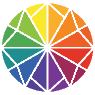

# ITTEN — LABORATÓRIO CROMÁTICO

## Manual Completo de Utilização e Referência Técnica

**Software:** Itten — Laboratório Cromático  
**Categoria:** Design, teoria das cores e acessibilidade digital  
**Plataforma:** Progressive Web App (PWA)  
**Idioma:** Português brasileiro  
**Tecnologias:** HTML5, CSS3, JavaScript e APIs nativas do navegador  
**Repositório:** https://github.com/magpe-stack/Itten  
**Aplicativo:** https://magpe-stack.github.io/Itten/

---

# PARTE I — APRESENTAÇÃO DO SOFTWARE

## 1. Introdução

O **Itten — Laboratório Cromático** é uma aplicação web progressiva destinada à criação, análise, organização e aplicação de paletas de cores em projetos digitais.

O software reúne ferramentas que permitem explorar relações cromáticas, extrair cores de imagens, avaliar a legibilidade de combinações, simular determinadas deficiências na percepção das cores e produzir recursos para utilização em interfaces e projetos de desenvolvimento web.

Sua proposta é oferecer um ambiente de experimentação cromática no qual o usuário possa percorrer diferentes etapas de trabalho sem precisar recorrer constantemente a ferramentas separadas.

O Itten não se limita a apresentar combinações de cores. Ele também oferece instrumentos para investigar como essas cores podem funcionar em situações práticas.

Entre suas principais aplicações estão:

- Desenvolvimento de identidades visuais.
- Planejamento cromático de websites.
- Criação de interfaces para aplicativos.
- Estudos de teoria das cores.
- Experimentação de harmonias cromáticas.
- Avaliação de contraste de textos.
- Extração de referências cromáticas de fotografias.
- Geração de gradientes.
- Produção de variáveis CSS.
- Preparação de configurações de cores para Tailwind CSS.

O aplicativo foi desenvolvido para funcionar diretamente no navegador, utilizando recursos nativos da plataforma web.

As principais operações são executadas localmente, sem exigir contas de usuário, serviços de inteligência artificial ou processamento remoto de imagens.

### 1.1. Objetivos

O Itten possui cinco objetivos principais.

**Exploração cromática:** permitir que o usuário experimente diferentes combinações de cores.

**Organização:** transformar referências isoladas em paletas estruturadas.

**Avaliação:** disponibilizar instrumentos para verificar contraste e investigar possíveis problemas de acessibilidade.

**Aplicação:** apresentar as cores em componentes de interface e composições gráficas.

**Exportação:** facilitar a utilização dos resultados em outros programas e projetos.

Esses objetivos estão distribuídos em oito módulos integrados.

### 1.2. Público-alvo

O aplicativo pode ser utilizado por:

- Designers gráficos.
- Designers de interfaces.
- Profissionais de UX/UI.
- Desenvolvedores frontend.
- Ilustradores.
- Artistas digitais.
- Professores de artes e design.
- Estudantes de teoria cromática.
- Criadores de conteúdo.
- Profissionais de comunicação visual.

Não é necessário conhecer programação para utilizar as ferramentas básicas.

Entretanto, conhecimentos de HTML, CSS e design de interfaces podem facilitar o aproveitamento dos recursos de exportação.

---

## 2. Origem e significado do nome Itten

O nome do aplicativo homenageia **Johannes Itten (1888–1967)**, pintor, professor e teórico suíço associado à escola Bauhaus.

Itten destacou-se por seus estudos sobre a organização das cores, os contrastes cromáticos e a percepção visual.

Sua abordagem enfatizava que uma cor não deve ser considerada apenas isoladamente.

A percepção de determinada cor pode variar conforme o contexto, a iluminação e as cores que aparecem ao seu redor.

Essa compreensão das relações cromáticas constitui uma das inspirações centrais do aplicativo.

### 2.1. Os sete contrastes cromáticos

Johannes Itten sistematizou sete modalidades de contraste:

1. **Contraste de matiz:** diferenças entre cores distintas.
2. **Contraste claro-escuro:** oposição entre valores luminosos.
3. **Contraste quente-frio:** relações perceptivas entre cores consideradas quentes e frias.
4. **Contraste complementar:** interação entre cores complementares.
5. **Contraste simultâneo:** influência perceptiva de uma cor sobre outra.
6. **Contraste de saturação:** oposição entre cores intensas e cores menos saturadas.
7. **Contraste de extensão:** relações entre proporções e áreas ocupadas pelas cores.

Esses conceitos continuam relevantes no ensino artístico e no desenvolvimento de sistemas visuais.

### 2.2. Relação entre a teoria de Itten e o aplicativo

O Itten utiliza a teoria cromática como referência conceitual.

Entretanto, é importante compreender que os cálculos do aplicativo utilizam modelos digitais de representação de cores, incluindo RGB e HSL.

O círculo cromático tradicional utilizado nas artes não é matematicamente idêntico ao espaço HSL.

Portanto, as harmonias produzidas pelo aplicativo são interpretações computacionais de relações cromáticas, não reproduções integrais do método histórico de Johannes Itten.

O aplicativo também não substitui instrumentos profissionais de medição de cores ou sistemas de gerenciamento colorimétrico.

### 2.3. Identidade visual

O Itten utiliza uma identidade visual unificada.

O mesmo símbolo gráfico é empregado como:

- Logotipo no cabeçalho.
- Favicon do navegador.
- Ícone do aplicativo instalado.

Os arquivos de ícone utilizados são:

- `icon-192.png`
- `icon-512.png`

A utilização de uma identidade visual consistente facilita o reconhecimento do aplicativo em diferentes dispositivos.

---

# PARTE II — ARQUITETURA E INSTALAÇÃO

## 3. Características técnicas

O Itten foi concebido como uma **Progressive Web App**, também denominada PWA.

Uma PWA é uma aplicação desenvolvida com tecnologias web que pode oferecer funcionalidades semelhantes às de aplicativos instaláveis.

O Itten utiliza:

- HTML5 para a estrutura da interface.
- CSS3 para apresentação visual e responsividade.
- JavaScript para lógica e interatividade.
- Canvas API para processamento de imagens e geração gráfica.
- LocalStorage para persistência de dados.
- Service Worker para gerenciamento do cache offline.
- Web App Manifest para informações de instalação.
- APIs nativas do navegador para seleção e exportação de arquivos.

### 3.1. Arquitetura local

O aplicativo executa suas principais operações no próprio dispositivo.

Isso significa que a geração de paletas, a conversão de cores e os cálculos de contraste não exigem consultas a servidores externos.

A extração de cores de imagens também é realizada localmente.

O arquivo selecionado é lido pelo navegador e processado por meio de recursos gráficos disponíveis no dispositivo.

### 3.2. Privacidade

O Itten não exige cadastro para utilização de suas ferramentas principais.

As imagens utilizadas no extrator cromático não precisam ser enviadas a servidores externos.

Os dados do projeto podem ser armazenados localmente pelo navegador.

Entretanto, isso não significa que os arquivos estejam automaticamente protegidos contra perda.

O usuário deve realizar exportações de segurança quando desejar conservar seus projetos.

### 3.3. Funcionamento offline

O aplicativo possui um Service Worker responsável por armazenar os arquivos essenciais em cache.

Entre esses arquivos estão:

- `index.html`
- `style.css`
- `app.js`
- `manifest.json`
- `icon-192.png`
- `icon-512.png`

Depois que os recursos necessários forem armazenados corretamente, o aplicativo poderá continuar funcionando sem conexão com a internet.

O primeiro acesso normalmente exige conexão.

A disponibilidade offline também depende das políticas de armazenamento do navegador.

### 3.4. Limitações da arquitetura

O Itten não possui sincronização automática entre dispositivos.

Os projetos armazenados em um navegador não aparecem automaticamente em outro.

A persistência local também não equivale a armazenamento permanente em nuvem.

Caso o navegador tenha seus dados apagados, os projetos poderão ser perdidos.

Por esse motivo, recomenda-se utilizar a exportação JSON para manter cópias de segurança.

---

## 4. Requisitos de utilização

O Itten foi projetado para funcionar em navegadores modernos.

Entre os navegadores que podem oferecer suporte às tecnologias utilizadas estão:

- Google Chrome.
- Microsoft Edge.
- Mozilla Firefox.
- Safari.

O suporte a recursos específicos pode variar conforme a versão do navegador e o sistema operacional.

### 4.1. Requisitos básicos

Para utilizar o aplicativo, recomenda-se:

1. Navegador atualizado.
2. JavaScript habilitado.
3. Armazenamento local disponível.
4. Permissão para selecionar arquivos do dispositivo.
5. Conexão inicial com a internet.

Não é necessário instalar ambientes de programação para utilizar a versão publicada.

### 4.2. Compatibilidade com dispositivos

O aplicativo possui interface responsiva.

Isso permite sua utilização em:

- Computadores de mesa.
- Notebooks.
- Tablets.
- Smartphones.

Em dispositivos móveis, os elementos são reorganizados conforme o espaço disponível.

Algumas operações com imagens grandes podem exigir mais memória e capacidade de processamento.

### 4.3. Acesso oficial

O aplicativo está disponível em:

https://magpe-stack.github.io/Itten/

O código-fonte e a documentação podem ser encontrados em:

https://github.com/magpe-stack/Itten

---

## 5. Instalação como aplicativo

O Itten pode ser instalado como PWA quando o navegador e o sistema operacional oferecem suporte a essa funcionalidade.

### 5.1. Instalação no computador

Em navegadores compatíveis:

1. Abra o endereço oficial do Itten.
2. Aguarde o carregamento da aplicação.
3. Procure a opção de instalação na barra de endereços ou no menu.
4. Selecione a opção para instalar.
5. Confirme a operação.

O aplicativo poderá aparecer no menu de programas ou como um atalho.

### 5.2. Instalação no Android

Em navegadores compatíveis:

1. Abra o Itten.
2. Acesse o menu do navegador.
3. Procure **Instalar aplicativo** ou **Adicionar à tela inicial**.
4. Confirme a instalação.

O procedimento pode variar conforme o navegador.

### 5.3. Instalação no iPhone ou iPad

No Safari:

1. Abra o aplicativo.
2. Acesse o menu de compartilhamento.
3. Procure a opção de adicionar à Tela de Início.
4. Confirme a operação.

A disponibilidade e os nomes dos controles dependem da versão do sistema.

### 5.4. Ausência da opção de instalação

Caso o navegador não apresente a opção de instalação:

- Verifique se o endereço utiliza HTTPS.
- Atualize a página.
- Confirme que o manifesto está acessível.
- Verifique se os arquivos de ícone existem.
- Aguarde o carregamento completo.
- Experimente um navegador com suporte à instalação PWA.

Nem todos os navegadores apresentam automaticamente um botão de instalação.

### 5.5. Desinstalação

O aplicativo pode ser removido pelos mecanismos de gerenciamento de aplicativos ou atalhos do sistema.

A desinstalação não garante a exclusão de todos os dados armazenados pelo navegador.

Para eliminar informações locais, pode ser necessário utilizar as configurações de armazenamento do próprio navegador.

Antes disso, exporte os projetos que desejar conservar.

---

# PARTE III — INTERFACE E NAVEGAÇÃO

## 6. Organização geral da interface

O Itten possui uma barra superior de gerenciamento e oito módulos principais.

A navegação ocorre em uma única página, por rolagem vertical.

### 6.1. Barra superior

A barra superior apresenta o logotipo, o nome do aplicativo e os comandos principais.

**Novo projeto:** inicia um novo projeto cromático.

**Imprimir:** abre o sistema de impressão do navegador.

**Importar:** permite selecionar um arquivo JSON de projeto.

**Exportar:** apresenta os formatos disponíveis para exportação.

**Alternar tema:** modifica a aparência do aplicativo entre claro e escuro.

**GitHub:** abre o repositório oficial.

**Ajuda:** abre a documentação publicada no GitHub.

### 6.2. Módulos de trabalho

Os módulos estão organizados da seguinte maneira:

**01. Cores-base**

Definição das referências cromáticas e configuração das harmonias.

**02. Paleta gerada**

Apresentação visual das cores calculadas.

**03. Extrator de imagem**

Identificação de cores predominantes em imagens.

**04. Simulador de daltonismo**

Visualização aproximada de alterações na percepção cromática.

**05. Laboratório de acessibilidade**

Análise de contraste segundo critérios WCAG.

**06. UI Preview Lab**

Aplicação visual da paleta em componentes de interface.

**07. Gradientes híbridos**

Geração de gradientes lineares, radiais e composições mesh.

**08. Design Tokens**

Produção de variáveis cromáticas para desenvolvimento web.

### 6.3. Tema claro e escuro

O aplicativo oferece dois modos de aparência.

O modo claro utiliza superfícies predominantemente claras.

O modo escuro utiliza superfícies predominantemente escuras.

A alternância é realizada pelo botão localizado na barra superior.

A preferência pode ser conservada no armazenamento local.

É importante distinguir o tema da interface do aplicativo dos temas utilizados no laboratório de visualização.

O usuário pode manter o Itten no modo claro e, simultaneamente, analisar uma interface escura no módulo de pré-visualização.

---

# PARTE IV — GERAÇÃO DE PALETAS

## 7. Módulo 01 — Cores-base

O módulo Cores-base é o ponto inicial recomendado para a construção de uma paleta.

Ele permite configurar três cores de referência.

Essas cores orientam a geração cromática conforme a modalidade de harmonia selecionada.

### 7.1. O que é uma cor-base?

Uma cor-base é uma referência cromática utilizada na construção de outras cores.

Ela pode representar:

- A cor principal de uma marca.
- Uma preferência estética.
- Uma cor presente em uma fotografia.
- Uma referência artística.
- Uma cor de identidade visual.
- Um ponto de partida para experimentação.

O Itten permite trabalhar com três referências.

### 7.2. Seleção visual

Cada cor pode ser escolhida utilizando o seletor disponibilizado pelo navegador.

A aparência desse seletor depende do sistema operacional.

O usuário pode escolher visualmente uma cor e confirmar a seleção.

### 7.3. Entrada hexadecimal

O aplicativo também utiliza códigos HEX.

Um código hexadecimal representa uma cor RGB por meio de seis caracteres.

Exemplos:

- `#FF0000` — vermelho.
- `#00FF00` — verde.
- `#0000FF` — azul.
- `#FFFFFF` — branco.
- `#000000` — preto.
- `#808080` — cinza.

Os caracteres representam os valores dos canais vermelho, verde e azul.

Cada canal pode assumir valores de 0 a 255.

### 7.4. Exemplo prático

Considere um projeto que utilize as seguintes cores:

**Cor-base 1:** `#3457D5`

**Cor-base 2:** `#F2A93B`

**Cor-base 3:** `#D65A83`

Essas referências podem ser utilizadas na geração de diferentes harmonias.

A composição final dependerá da modalidade selecionada e da quantidade de cores desejada.

### 7.5. Gerar cores

O botão **Gerar cores** produz novas referências cromáticas automaticamente.

Esse recurso é útil para experimentação.

Cada execução pode gerar resultados diferentes.

A geração automática não garante que a paleta será adequada para qualquer finalidade.

É necessário avaliar o resultado conforme o contexto de aplicação.

### 7.6. Recalcular paleta

O botão **Recalcular paleta** atualiza a combinação cromática a partir das configurações selecionadas.

Ele pode ser utilizado depois de modificar:

- As cores-base.
- A modalidade de harmonia.
- A quantidade de cores.

### 7.7. Recomendações

Para projetos com identidade visual definida, utilize inicialmente as cores oficiais.

Para projetos exploratórios, experimente a geração automática.

Para interfaces digitais, avalie posteriormente a legibilidade e os contrastes.

---

## 8. Harmonias cromáticas

O Itten oferece diferentes modalidades de harmonia.

Essas modalidades utilizam relações matemáticas entre matizes no espaço cromático digital.

### 8.1. Harmonia integrada

A harmonia integrada utiliza as três cores-base como referências para a construção da paleta.

É especialmente útil quando o projeto já possui mais de uma cor importante.

Essa modalidade procura aproveitar simultaneamente as referências selecionadas.

### 8.2. Harmonia complementar

A harmonia complementar utiliza matizes aproximadamente opostos no círculo cromático.

No modelo HSL, uma relação complementar idealizada corresponde a uma diferença de 180 graus.

Exemplos conceituais incluem azul e laranja, vermelho e ciano, verde e magenta.

As combinações complementares podem produzir contrastes visuais intensos.

### 8.3. Harmonia análoga

A harmonia análoga utiliza matizes próximos.

Exemplos conceituais:

- Azul e azul-esverdeado.
- Verde e verde-amarelado.
- Amarelo e laranja.

Essa estratégia favorece continuidade visual.

Entretanto, cores próximas não garantem contraste suficiente para textos.

### 8.4. Harmonia triádica

A harmonia triádica utiliza três matizes distribuídos aproximadamente a intervalos de 120 graus.

Ela pode produzir combinações variadas e expressivas.

É recomendável estabelecer uma hierarquia entre as cores para evitar competição visual excessiva.

### 8.5. Complementar dividida

A harmonia complementar dividida utiliza um matiz principal e dois matizes próximos de sua complementar.

Ela oferece uma alternativa à combinação complementar direta.

Pode ser útil para projetos que necessitam de contraste e variedade.

### 8.6. Harmonia tetrádica

A harmonia tetrádica utiliza quatro referências cromáticas.

Uma configuração possível corresponde a dois pares complementares.

É uma estratégia adequada para exploração de sistemas cromáticos mais complexos.

O excesso de cores, entretanto, pode prejudicar a organização visual.

### 8.7. Harmonia monocromática

A harmonia monocromática utiliza variações relacionadas a um matiz principal.

Essas variações podem envolver luminosidade e saturação.

É útil para interfaces discretas e identidades visuais consistentes.

Mesmo em sistemas monocromáticos, é necessário avaliar contraste e legibilidade.

### 8.8. Como escolher uma harmonia

A escolha depende da finalidade do projeto.

Não existe uma harmonia universalmente superior.

Projetos institucionais podem exigir sobriedade.

Interfaces de monitoramento podem exigir distinções claras entre estados.

Ilustrações podem se beneficiar de combinações mais expressivas.

A teoria cromática oferece referências, mas a decisão final deve considerar o contexto de utilização.

---

## 9. Quantidade de cores

O Itten permite configurar paletas com:

- 5 cores.
- 6 cores.
- 8 cores.
- 10 cores.
- 12 cores.

A quantidade deve ser escolhida conforme a complexidade do projeto.

### 9.1. Paletas pequenas

Paletas de cinco ou seis cores podem ser suficientes para projetos simples.

Elas facilitam a manutenção da consistência visual.

### 9.2. Paletas intermediárias

Paletas de oito ou dez cores oferecem maior flexibilidade.

Podem ser úteis em interfaces com diferentes superfícies, gráficos e componentes.

### 9.3. Paletas amplas

Paletas de doze cores podem atender projetos mais complexos.

Entretanto, utilizar mais cores não significa necessariamente melhorar a qualidade visual.

É recomendável estabelecer funções específicas para cada cor.

### 9.4. Organização funcional

Uma paleta pode ser organizada em categorias como:

- Principal.
- Secundária.
- Destaque.
- Fundo.
- Superfície.
- Texto.
- Borda.
- Estado ou alerta.

Essas categorias representam sugestões de utilização.

A atribuição de funções deve considerar o contraste e o contexto.

---

## 10. Módulo 02 — Paleta gerada

O módulo Paleta gerada apresenta visualmente a combinação cromática calculada.

Cada amostra representa uma cor e permite consultar seu código hexadecimal.

### 10.1. Visualização

As cores aparecem organizadas em uma grade.

A disposição pode variar conforme a largura da tela.

O resultado permite comparar as cores simultaneamente.

### 10.2. Copiar códigos HEX

O usuário pode selecionar uma amostra para copiar seu código.

O valor poderá ser utilizado em outros programas.

Exemplo:

```css
.botao-principal {
  background-color: #3457D5;
}
```

### 10.3. Fidelidade cromática

A aparência das cores depende das características do dispositivo.

Monitores diferentes podem apresentar diferenças de luminosidade, saturação e reprodução cromática.

O Itten não substitui equipamentos profissionais de calibração.

### 10.4. Critérios de avaliação

Antes de adotar uma paleta, recomenda-se observar:

**Coerência:** as cores apresentam uma relação visual satisfatória?

**Hierarquia:** existe distinção entre elementos principais e secundários?

**Contraste:** os textos permanecem legíveis?

**Versatilidade:** as cores funcionam em diferentes superfícies?

**Adequação:** a combinação corresponde à finalidade do projeto?

O Itten oferece módulos adicionais para aprofundar essas avaliações.

---

# PARTE V — EXTRAÇÃO CROMÁTICA DE IMAGENS

## 11. Módulo 03 — Extrator de imagem

O módulo **Extrator de imagem** permite identificar cores predominantes em fotografias, ilustrações e outros arquivos gráficos.

A ferramenta foi desenvolvida para transformar imagens em referências cromáticas que possam ser aproveitadas na criação de paletas.

Em vez de escolher manualmente cada cor, o usuário pode utilizar uma imagem como ponto de partida para seu projeto.

### 11.1. Finalidade

A extração cromática pode ser útil em diferentes situações:

- Desenvolvimento de identidades visuais inspiradas em fotografias.
- Criação de paletas para websites.
- Planejamento de interfaces.
- Estudos de composição cromática.
- Identificação de cores dominantes em ilustrações.
- Desenvolvimento de apresentações.
- Produção de materiais editoriais.
- Exploração de referências artísticas.

Imagine, por exemplo, uma fotografia de uma paisagem com vegetação, céu e construções.

O extrator poderá identificar algumas das cores predominantes e apresentá-las como amostras.

Essas cores poderão servir como referências para uma nova paleta.

### 11.2. Formatos de imagem

O seletor de arquivos do Itten está configurado para aceitar:

| Formato | Extensão | Características |
|---|---|---|
| JPEG | `.jpg`, `.jpeg` | Fotografias e imagens comprimidas |
| PNG | `.png` | Imagens com ou sem transparência |
| WebP | `.webp` | Formato moderno de imagem |

A aceitação pelo seletor não garante que todos os arquivos serão decodificados corretamente.

Arquivos corrompidos, excessivamente grandes ou incompatíveis com o navegador poderão apresentar problemas.

### 11.3. Como selecionar uma imagem

Para utilizar o extrator:

1. Localize o módulo **03. Extrator de imagem**.
2. Clique ou toque na área indicada para seleção de imagens.
3. Escolha um arquivo no dispositivo.
4. Confirme a seleção.
5. Aguarde o processamento.
6. Observe as cores identificadas.

A interface também disponibiliza uma área destinada a arrastar e soltar arquivos.

Esse procedimento é especialmente conveniente em computadores.

### 11.4. Arrastar e soltar

Quando o navegador e o dispositivo oferecem suporte:

1. Abra a pasta que contém a imagem.
2. Selecione o arquivo desejado.
3. Arraste-o até a área de upload do Itten.
4. Solte o arquivo.
5. Aguarde o processamento.

Em smartphones, a seleção pelo gerenciador de arquivos costuma ser mais prática.

### 11.5. Como funciona a extração

O processamento cromático utiliza a API Canvas do navegador.

De maneira simplificada, o procedimento envolve:

1. Carregar a imagem selecionada.
2. Obter uma representação gráfica adequada ao processamento.
3. Examinar os valores cromáticos dos pixels.
4. Agrupar cores semelhantes segundo critérios do algoritmo.
5. Identificar grupos representativos.
6. Apresentar as cores resultantes.

O processo pode envolver redução de resolução e quantização cromática.

Essas operações ajudam a diminuir a quantidade de informações necessárias para a análise.

### 11.6. O que é quantização cromática?

Uma fotografia pode conter milhares ou milhões de variações de cor.

Mesmo regiões aparentemente uniformes apresentam pequenas diferenças decorrentes de iluminação, textura, compressão e ruído.

A quantização reduz essas variações a um conjunto menor de grupos cromáticos.

Por exemplo, diferentes tonalidades próximas de azul podem ser reunidas em uma referência representativa.

Isso torna possível produzir uma paleta compacta a partir de uma imagem complexa.

Entretanto, a quantização implica perda de detalhes.

Portanto, o resultado deve ser compreendido como uma aproximação das cores predominantes.

### 11.7. Aplicar cores extraídas

Depois do processamento, o aplicativo apresenta as amostras identificadas.

O botão **Aplicar cores extraídas** permite utilizar o resultado como referência para o projeto cromático.

O botão permanece desabilitado enquanto não houver uma extração válida disponível.

Após aplicar as cores, recomenda-se revisar a paleta gerada e verificar se ela corresponde à intenção visual do projeto.

### 11.8. Imagens com transparência

Arquivos PNG e WebP podem conter áreas transparentes.

A interpretação dessas áreas depende do processamento realizado pelo navegador e pelo algoritmo.

Em determinadas situações, a transparência poderá influenciar as cores analisadas.

Para resultados mais previsíveis, utilize imagens com fundo definido quando a transparência não for necessária.

### 11.9. Imagens muito grandes

Fotografias de alta resolução podem exigir memória e processamento adicionais.

Em dispositivos com recursos limitados, isso pode provocar:

- Demora no processamento.
- Travamentos temporários.
- Falha na decodificação.
- Encerramento da operação pelo navegador.

Caso isso aconteça, tente utilizar uma versão reduzida da imagem.

Uma imagem menor geralmente é suficiente para identificar referências cromáticas predominantes.

### 11.10. Limitações do extrator

O extrator não realiza uma análise semântica da imagem.

Ele não identifica necessariamente objetos, pessoas, paisagens ou elementos importantes do ponto de vista artístico.

Uma cor que ocupa grande parte da imagem pode receber maior representação mesmo que não seja a cor visualmente mais importante para o usuário.

Da mesma forma, uma pequena área de cor intensa pode não aparecer entre as referências predominantes.

O resultado também depende do algoritmo de agrupamento.

O extrator não deve ser utilizado como instrumento profissional de medição colorimétrica.

### 11.11. Privacidade das imagens

O processamento é realizado localmente pelo navegador.

A ferramenta não necessita enviar a fotografia a um servidor externo para identificar suas cores.

Isso representa uma vantagem para usuários que trabalham com imagens pessoais ou materiais ainda não publicados.

Entretanto, o usuário continua responsável por proteger os arquivos originais em seu dispositivo.

### 11.12. Boas práticas

Para melhorar os resultados:

- Prefira imagens nítidas.
- Utilize arquivos em formatos compatíveis.
- Evite fotografias com iluminação excessivamente irregular quando desejar uma paleta equilibrada.
- Experimente diferentes recortes da mesma imagem.
- Compare os resultados com a composição original.
- Avalie as cores extraídas antes de aplicá-las definitivamente.
- Utilize o laboratório de acessibilidade para testar combinações destinadas a interfaces.

---

# PARTE VI — PERCEPÇÃO CROMÁTICA E DALTONISMO

## 12. Módulo 04 — Simulador de daltonismo

O módulo **Simulador de daltonismo** apresenta visualizações aproximadas de como determinadas alterações na percepção das cores podem afetar uma paleta.

A ferramenta possui finalidade exploratória e educativa.

Ela permite observar se algumas cores podem se tornar visualmente semelhantes em determinadas condições simuladas.

### 12.1. O que é daltonismo?

Daltonismo é um termo frequentemente utilizado para descrever alterações na percepção cromática.

Essas alterações podem envolver diferenças na sensibilidade ou no funcionamento dos mecanismos visuais responsáveis pela distinção entre determinadas regiões do espectro.

Existem diferentes tipos e graus de deficiência na visão de cores.

Não existe uma única forma de percepção cromática que represente todas as pessoas com daltonismo.

### 12.2. Por que simular alterações cromáticas?

Em projetos digitais, a cor frequentemente transmite informações importantes.

Exemplos:

- Verde para indicar sucesso.
- Vermelho para indicar erro.
- Amarelo para indicar atenção.
- Azul para representar determinada categoria.
- Cores distintas para identificar séries de gráficos.

Quando a informação depende exclusivamente da diferença entre cores, alguns usuários podem ter dificuldade para interpretá-la.

O simulador ajuda a identificar situações que merecem avaliação adicional.

### 12.3. Modos disponíveis

O Itten apresenta quatro opções:

| Modo | Descrição |
|---|---|
| Visão padrão | Apresentação original das cores |
| Protanopia | Simulação aproximada de uma deficiência relacionada à percepção do vermelho |
| Deuteranopia | Simulação aproximada de uma deficiência relacionada à percepção do verde |
| Tritanopia | Simulação aproximada de uma deficiência relacionada à percepção do azul |

Essas descrições são simplificadas.

As alterações reais de percepção são mais complexas do que a simples ausência de uma cor.

### 12.4. Protanopia

A protanopia é uma forma de deficiência da visão de cores associada à ausência funcional dos cones L.

Ela pode alterar a distinção entre determinadas combinações cromáticas, especialmente na região tradicionalmente descrita como vermelho-verde.

O simulador apresenta uma transformação aproximada da paleta para facilitar a comparação.

### 12.5. Deuteranopia

A deuteranopia está associada à ausência funcional dos cones M.

Também pode afetar a distinção entre determinadas combinações tradicionalmente classificadas como vermelho-verde.

A transformação visual apresentada pelo aplicativo não representa necessariamente a percepção exata de uma pessoa com essa condição.

### 12.6. Tritanopia

A tritanopia é uma deficiência menos comum, associada à ausência funcional dos cones S.

Pode afetar a distinção entre determinadas combinações cromáticas, especialmente na região azul-amarelo.

O Itten apresenta uma aproximação computacional dessa condição.

### 12.7. Como utilizar o simulador

1. Gere uma paleta no módulo 01.
2. Localize o módulo **04. Simulador de daltonismo**.
3. Abra o seletor **Simulação**.
4. Escolha uma das modalidades.
5. Observe as amostras transformadas.
6. Compare o resultado com a paleta original.
7. Repita a análise com outras modalidades.

O procedimento pode ser repetido sempre que as cores do projeto forem alteradas.

### 12.8. Interpretação dos resultados

Observe especialmente se:

- Duas cores distintas passam a parecer semelhantes.
- Um destaque visual perde diferenciação.
- Categorias representadas apenas por cores tornam-se difíceis de distinguir.
- Uma combinação apresenta menor separação perceptiva.

Essas observações não constituem um diagnóstico de acessibilidade.

Elas indicam situações que merecem atenção.

### 12.9. Limitações das simulações

O Itten utiliza transformações matemáticas aproximadas.

As simulações não representam integralmente a diversidade das experiências individuais.

Além disso, a aparência depende da tela, do brilho, do gerenciamento de cores e das condições de visualização.

Por isso, o simulador não substitui:

- Testes com usuários.
- Avaliações especializadas de acessibilidade.
- Verificação de contraste.
- Revisão das informações transmitidas por cor.
- Ferramentas de análise perceptiva mais avançadas.

### 12.10. Recomendações de acessibilidade

Evite depender exclusivamente da cor para comunicar informações importantes.

Em vez de utilizar apenas vermelho para indicar um erro, apresente também:

- Uma mensagem textual.
- Um ícone identificável.
- Uma borda ou padrão visual.
- Uma indicação de estado compreensível.

Em gráficos, utilize legendas, rótulos, padrões ou marcadores quando necessário.

O objetivo é preservar a informação mesmo quando a distinção cromática estiver reduzida.

---

# PARTE VII — ACESSIBILIDADE DIGITAL

## 13. Módulo 05 — Laboratório de acessibilidade

O módulo **Laboratório de acessibilidade** permite avaliar o contraste entre cores de texto e fundo.

O objetivo é ajudar o usuário a identificar combinações que atendam a determinados critérios das Web Content Accessibility Guidelines, conhecidas pela sigla WCAG.

As WCAG são diretrizes internacionais de acessibilidade para conteúdos digitais.

### 13.1. Por que o contraste é importante?

A legibilidade depende de diversos fatores:

- Tamanho da fonte.
- Espessura dos caracteres.
- Família tipográfica.
- Espaçamento.
- Luminosidade.
- Contraste entre texto e fundo.
- Condições de visualização.
- Características visuais do usuário.

O contraste cromático é um desses fatores.

Textos com contraste insuficiente podem ser difíceis de ler, especialmente em telas pequenas ou sob iluminação desfavorável.

### 13.2. O que o laboratório avalia?

O módulo permite selecionar uma cor para o texto e outra para o fundo.

O aplicativo calcula a relação de contraste entre essas duas cores.

O resultado é apresentado juntamente com indicações relacionadas aos critérios WCAG implementados.

### 13.3. Seleção das cores

O laboratório possui dois seletores:

**Texto:** determina a cor utilizada como primeiro plano.

**Fundo:** determina a cor utilizada como superfície de referência.

As opções são construídas a partir das cores disponíveis no sistema cromático do aplicativo.

### 13.4. Como executar uma análise

1. Gere ou configure uma paleta.
2. Localize o módulo **05. Laboratório de acessibilidade**.
3. Escolha uma cor no seletor **Texto**.
4. Escolha uma cor no seletor **Fundo**.
5. Observe a relação de contraste.
6. Consulte os indicadores de conformidade.
7. Experimente outras combinações.

É recomendável testar mais de uma combinação.

Uma cor pode funcionar adequadamente sobre determinada superfície e apresentar contraste insuficiente sobre outra.

---

## 14. Relação de contraste WCAG

A relação de contraste utilizada nas WCAG 2.x baseia-se na luminância relativa das cores.

O cálculo considera os valores dos canais RGB após a transformação apropriada para luminância linear.

### 14.1. Fórmula de contraste

A relação é calculada por:

**Contraste = (L1 + 0,05) / (L2 + 0,05)**

Onde:

- `L1` representa a maior luminância relativa.
- `L2` representa a menor luminância relativa.

A relação varia de:

**1:1** — ausência de diferença de luminância.

Até aproximadamente:

**21:1** — contraste máximo entre preto e branco no modelo considerado.

### 14.2. Luminância relativa

A luminância relativa é calculada a partir dos canais RGB linearizados.

Para cada canal normalizado entre 0 e 1, aplica-se a transformação sRGB definida pelo método WCAG.

Depois, os canais são combinados com os seguintes coeficientes:

**L = 0,2126 R + 0,7152 G + 0,0722 B**

Os valores `R`, `G` e `B` dessa expressão são os canais linearizados, não os valores hexadecimais originais.

### 14.3. Interpretação

Quanto maior a relação de contraste, maior a diferença de luminância entre as duas cores.

Entretanto, contraste elevado não garante automaticamente uma experiência visual confortável.

Outros fatores, como tipografia, espaçamento, quantidade de texto e características da tela, também influenciam a leitura.

### 14.4. Exemplos conceituais

O contraste entre preto puro e branco puro corresponde a aproximadamente 21:1.

Duas cores muito próximas em luminância podem apresentar relações próximas de 1:1.

A diferença de matiz, isoladamente, não determina a relação de contraste.

Duas cores visualmente diferentes podem possuir luminâncias semelhantes.

Por isso, a avaliação matemática é importante.

---

## 15. Critérios WCAG para textos

Os critérios de contraste mais conhecidos das WCAG 2.x utilizam diferentes limites conforme o tamanho do texto e o nível de conformidade.

### 15.1. Nível AA — Texto normal

Para texto normal, o critério WCAG 1.4.3 estabelece uma relação mínima de:

**4,5:1**

Essa é uma referência fundamental para a avaliação de textos em interfaces digitais.

### 15.2. Nível AA — Texto grande

Para texto grande, o limite é:

**3:1**

Segundo a definição utilizada nas WCAG 2.x, texto grande corresponde, em geral, a pelo menos 18 pontos em peso normal ou 14 pontos em negrito, com as equivalências tipográficas apropriadas.

A classificação depende do tamanho e da apresentação efetiva do texto.

### 15.3. Nível AAA — Texto normal

Para texto normal, o nível AAA utiliza:

**7:1**

Esse limite é mais exigente que o nível AA.

### 15.4. Nível AAA — Texto grande

Para texto grande, o limite é:

**4,5:1**

### 15.5. Tabela de referência

| Critério | Relação mínima |
|---|---:|
| AA — Texto normal | 4,5:1 |
| AA — Texto grande | 3:1 |
| AAA — Texto normal | 7:1 |
| AAA — Texto grande | 4,5:1 |

### 15.6. Como interpretar uma aprovação

Quando uma combinação atinge o limite matemático de determinado critério, ela satisfaz aquela exigência de contraste para as condições às quais o critério se aplica.

Isso não significa que toda a interface esteja automaticamente acessível.

A conformidade geral exige avaliar outros requisitos.

### 15.7. Componentes não textuais

As WCAG 2.1 também incluem o critério 1.4.11, relacionado ao contraste de determinados componentes de interface e objetos gráficos necessários à compreensão.

O limite de referência é de 3:1 em situações abrangidas por esse critério.

Esse requisito não deve ser confundido com os limites aplicáveis a textos.

O usuário deve verificar separadamente se bordas, indicadores, ícones e estados visuais atendem às exigências pertinentes.

### 15.8. Exceções e contexto

As diretrizes WCAG possuem condições e exceções específicas.

Por exemplo, determinadas categorias de texto incidental ou logotipos não estão sujeitas às mesmas exigências do texto comum no critério 1.4.3.

O laboratório apresenta uma avaliação matemática de cores, não uma auditoria integral de conformidade.

Para decisões formais, consulte a documentação oficial:

https://www.w3.org/WAI/WCAG22/Understanding/contrast-minimum.html

---

## 16. Validação simultânea dos temas

O Itten possui uma área denominada **Validador simultâneo de temas**.

Sua finalidade é facilitar a avaliação de combinações cromáticas relacionadas a interfaces claras e escuras.

### 16.1. Por que avaliar dois temas?

Uma interface pode oferecer modos claro e escuro.

Nesses casos, a mesma cor de destaque pode apresentar comportamentos diferentes conforme a superfície.

Uma tonalidade que funciona sobre fundo branco pode perder legibilidade sobre fundo preto.

O inverso também pode acontecer.

Por isso, não é suficiente avaliar apenas uma apresentação.

### 16.2. Tema claro

No tema claro, as superfícies costumam apresentar luminância elevada.

Textos escuros geralmente oferecem melhor contraste.

Entretanto, botões, etiquetas e indicadores podem exigir combinações específicas.

### 16.3. Tema escuro

No tema escuro, as superfícies apresentam luminância reduzida.

Textos claros costumam ser necessários.

Porém, nem todas as cores claras são igualmente adequadas para grandes áreas ou elementos interativos.

### 16.4. Como utilizar

1. Gere a paleta desejada.
2. Abra o Laboratório de acessibilidade.
3. Localize o validador simultâneo.
4. Observe os resultados apresentados para as referências de tema.
5. Identifique combinações com contraste insuficiente.
6. Ajuste as cores do projeto quando necessário.
7. Repita a avaliação.

### 16.5. Limitações

A avaliação simultânea utiliza as combinações definidas pela implementação do aplicativo.

Ela não conhece automaticamente todos os componentes ou estados de uma interface externa.

Portanto, os resultados devem ser utilizados como referência inicial.

Para um produto final, é necessário testar os componentes reais.

### 16.6. Recomendações

Ao construir interfaces com dois temas:

- Defina cores de texto específicas para cada tema.
- Evite pressupor que uma cor funciona igualmente em ambos.
- Verifique textos pequenos.
- Avalie estados de foco e seleção.
- Teste botões e mensagens de alerta.
- Não dependa exclusivamente da cor para comunicar estados.

---

## 17. Boas práticas de acessibilidade cromática

A acessibilidade cromática exige mais do que selecionar cores visualmente agradáveis.

É necessário considerar a função de cada elemento e a forma como as informações são apresentadas.

### 17.1. Não utilizar somente cores

Sempre que possível, combine informações cromáticas com outros sinais.

Por exemplo, um campo inválido pode apresentar uma borda diferenciada e uma mensagem explicativa.

Isso reduz a dependência da percepção de uma cor específica.

### 17.2. Priorizar legibilidade

Textos informativos devem receber atenção especial.

Evite combinações com contraste insuficiente.

Considere também o tamanho da fonte, a espessura dos caracteres e o espaçamento.

### 17.3. Avaliar estados interativos

Botões e controles podem possuir estados como:

- Normal.
- Hover.
- Foco.
- Pressionado.
- Selecionado.
- Desabilitado.

Esses estados precisam ser compreensíveis.

A mudança de cor nem sempre é suficiente para diferenciá-los.

### 17.4. Cuidado com gradientes

Textos sobre gradientes exigem atenção adicional.

Uma combinação pode apresentar bom contraste em determinada região e contraste insuficiente em outra.

Quando possível, utilize superfícies estáveis atrás de textos importantes.

### 17.5. Avaliar gráficos

Gráficos que utilizam cores para distinguir categorias devem apresentar recursos adicionais quando necessário.

Exemplos:

- Legendas claras.
- Rótulos.
- Marcadores.
- Padrões.
- Diferenças de forma.

### 17.6. Testar em diferentes telas

A reprodução cromática varia conforme o dispositivo.

Sempre que possível, verifique a interface em mais de uma tela.

Considere também situações de iluminação ambiente intensa.

### 17.7. Validar com ferramentas complementares

O Itten pode auxiliar na análise inicial.

Entretanto, uma avaliação completa de acessibilidade deve incluir ferramentas e procedimentos complementares.

Entre eles:

- Inspeção dos componentes reais.
- Navegação por teclado.
- Verificação de foco visível.
- Testes com leitores de tela.
- Avaliação de zoom.
- Verificação de estrutura semântica.
- Testes com usuários.

### 17.8. Responsabilidade pela aplicação

O aplicativo fornece informações para apoiar decisões de design.

A responsabilidade pela conformidade de um produto final permanece com quem desenvolve e publica esse produto.

A aprovação de uma combinação cromática em um teste específico não equivale à certificação de acessibilidade de toda uma aplicação.

---


# PARTE VIII — VISUALIZAÇÃO DE INTERFACES

## 18. Módulo 06 — UI Preview Lab

O módulo **UI Preview Lab** permite observar como as cores de uma paleta podem ser aplicadas a componentes de interfaces digitais.

A finalidade é aproximar a experimentação cromática de situações reais de design.

Uma paleta pode apresentar uma combinação visualmente interessante quando suas cores são exibidas lado a lado. Entretanto, essa mesma combinação pode produzir resultados diferentes quando aplicada a textos, botões, cartões e superfícies.

O UI Preview Lab oferece um ambiente de visualização para investigar essas relações.

### 18.1. Finalidade do módulo

O laboratório de pré-visualização foi concebido para facilitar a avaliação de:

- Cores principais de interfaces.
- Superfícies claras e escuras.
- Elementos de destaque.
- Botões.
- Textos.
- Cartões.
- Hierarquia cromática.
- Coerência visual entre componentes.

A ferramenta permite observar a paleta aplicada a exemplos de interface, sem exigir que o usuário construa uma página HTML para cada experimentação.

### 18.2. Pré-visualização em tema claro

O primeiro ambiente apresenta uma interface com características de tema claro.

Nesse contexto, predominam superfícies claras, sobre as quais são aplicadas cores derivadas da paleta.

O usuário pode observar como as tonalidades selecionadas interagem com elementos típicos de interfaces digitais.

É importante verificar se as cores de destaque continuam reconhecíveis e se os textos apresentam contraste adequado.

### 18.3. Pré-visualização em tema escuro

O segundo ambiente apresenta uma interface com características de tema escuro.

A visualização permite observar como a mesma paleta se comporta em superfícies de menor luminosidade.

Algumas cores podem parecer mais intensas quando utilizadas sobre fundos escuros.

Outras podem perder diferenciação ou produzir desconforto visual.

### 18.4. Como utilizar

1. Configure as três cores-base.
2. Selecione a modalidade de harmonia.
3. Defina a quantidade de cores.
4. Gere ou recalcule a paleta.
5. Localize o módulo **06. UI Preview Lab**.
6. Observe a aplicação em tema claro.
7. Compare com a aplicação em tema escuro.
8. Ajuste a paleta conforme necessário.

O procedimento pode ser repetido até que a combinação apresente resultados satisfatórios.

### 18.5. O que observar

Durante a avaliação, considere:

**Hierarquia:** os elementos principais recebem destaque suficiente?

**Consistência:** as cores parecem pertencer ao mesmo sistema?

**Legibilidade:** os textos são facilmente identificáveis?

**Equilíbrio:** a distribuição cromática evita excesso de estímulos?

**Versatilidade:** a paleta mantém sua identidade nos dois temas?

**Aplicabilidade:** a combinação parece adequada à finalidade do projeto?

### 18.6. Diferença entre visualização e validação

O UI Preview Lab é uma ferramenta de demonstração visual.

Ele não substitui o Laboratório de acessibilidade.

Uma combinação que parece agradável pode apresentar contraste insuficiente segundo os critérios WCAG.

Por isso, recomenda-se utilizar os dois módulos de maneira complementar.

### 18.7. Limitações

O UI Preview Lab não representa automaticamente todas as condições de uma aplicação real.

Ele não substitui testes de:

- Responsividade de um projeto externo.
- Navegação por teclado.
- Leitores de tela.
- Estados de interação.
- Componentes complexos.
- Conteúdo dinâmico.
- Acessibilidade integral.

O resultado deve ser interpretado como uma referência visual.

---

# PARTE IX — GRADIENTES CROMÁTICOS

## 19. Módulo 07 — Gradientes híbridos

O módulo **Gradientes híbridos** permite produzir composições cromáticas utilizando as cores da paleta.

Os gradientes são recursos gráficos nos quais ocorre uma transição entre duas ou mais cores.

Eles podem ser empregados em fundos, cartões, banners, cabeçalhos, elementos decorativos e outras superfícies digitais.

O Itten disponibiliza três modalidades:

1. Linear.
2. Radial.
3. Mesh.

### 19.1. Finalidade

O módulo permite transformar uma paleta em composições gráficas contínuas.

Isso amplia as possibilidades de aplicação das cores geradas.

Em vez de utilizar apenas superfícies de cor uniforme, o usuário pode explorar transições e sobreposições cromáticas.

### 19.2. Atualização dos gradientes

Os gradientes são calculados a partir das cores disponíveis no projeto.

Quando a paleta é modificada, as composições podem ser atualizadas para refletir as novas referências.

### 19.3. Visualização

Cada modalidade possui uma área de pré-visualização.

Essa área apresenta o resultado gráfico antes da cópia do código.

O usuário pode comparar as três modalidades e escolher a mais adequada ao projeto.

---

## 20. Gradiente linear

O gradiente linear apresenta uma transição cromática ao longo de uma direção.

Essa direção pode ser horizontal, vertical ou diagonal, conforme a configuração utilizada.

### 20.1. Funcionamento

Em CSS, gradientes lineares são definidos pela função:

`linear-gradient()`

Exemplo ilustrativo:

```css
.banner {
  background: linear-gradient(
    135deg,
    #3457D5,
    #F2A93B,
    #D65A83
  );
}
```

Nesse exemplo, a transição ocorre ao longo de uma direção diagonal.

As cores são distribuídas entre os pontos definidos.

O código acima é demonstrativo e não representa necessariamente a saída exata do aplicativo.

### 20.2. Aplicações

Gradientes lineares podem ser utilizados em:

- Cabeçalhos.
- Banners.
- Botões.
- Cartões.
- Fundos de páginas.
- Elementos decorativos.
- Apresentações digitais.

### 20.3. Cuidados

Evite utilizar gradientes intensos atrás de textos longos.

O contraste pode variar conforme a posição do texto sobre o fundo.

Uma cor de texto que funciona em uma extremidade do gradiente pode não funcionar na outra.

### 20.4. Copiar CSS

Para copiar o gradiente:

1. Gere uma paleta.
2. Localize o módulo de gradientes.
3. Observe a pré-visualização linear.
4. Clique em **Copiar CSS** no cartão correspondente.
5. Cole o código em sua folha de estilos.

O código poderá ser ajustado posteriormente no projeto de destino.

---

## 21. Gradiente radial

O gradiente radial apresenta transições cromáticas que se expandem a partir de uma região central ou de um ponto definido.

Em CSS, utiliza-se:

`radial-gradient()`

### 21.1. Exemplo ilustrativo

```css
.superficie {
  background: radial-gradient(
    circle at center,
    #F2A93B,
    #3457D5,
    #D65A83
  );
}
```

O exemplo apresenta uma transição radial entre três cores.

A distribuição visual depende da forma, da posição e das dimensões da superfície.

### 21.2. Aplicações

Gradientes radiais podem ser utilizados em:

- Fundos decorativos.
- Áreas de destaque.
- Cartões promocionais.
- Elementos circulares.
- Composições abstratas.
- Interfaces experimentais.

### 21.3. Diferenças em relação ao gradiente linear

O gradiente linear organiza a transição ao longo de uma direção.

O radial organiza a transição a partir de um ponto ou região.

Essas características produzem efeitos visuais diferentes, mesmo quando são utilizadas as mesmas cores.

### 21.4. Copiar CSS

O procedimento é semelhante ao utilizado para gradientes lineares.

Selecione **Copiar CSS** no cartão radial e utilize o resultado no projeto desejado.

---

## 22. Gradiente mesh

O termo **mesh gradient** é utilizado para descrever composições com transições cromáticas distribuídas por diferentes regiões de uma superfície.

Em aplicações web, esse efeito pode ser aproximado por meio da sobreposição de múltiplos gradientes.

### 22.1. Funcionamento

O Itten utiliza uma composição CSS para produzir uma aparência semelhante a um gradiente mesh.

Essa técnica não deve ser confundida com uma malha vetorial editável por pontos de controle, como as encontradas em determinados programas gráficos.

### 22.2. Exemplo ilustrativo

```css
.mesh {
  background:
    radial-gradient(
      circle at 20% 30%,
      #3457D5,
      transparent 55%
    ),
    radial-gradient(
      circle at 80% 25%,
      #F2A93B,
      transparent 55%
    ),
    radial-gradient(
      circle at 50% 85%,
      #D65A83,
      transparent 60%
    ),
    #FFFFFF;
}
```

Nesse exemplo, três gradientes radiais são sobrepostos.

O resultado pode produzir uma composição cromática com diferentes regiões de concentração.

O exemplo é demonstrativo.

### 22.3. Aplicações

Gradientes do tipo mesh podem ser utilizados em:

- Fundos de páginas.
- Interfaces criativas.
- Apresentações.
- Banners.
- Cartões.
- Identidades visuais digitais.
- Composições abstratas.

### 22.4. Limitações

O resultado depende do mecanismo de renderização CSS do navegador.

A aparência também pode variar conforme:

- Dimensões da superfície.
- Resolução da tela.
- Proporção do elemento.
- Posicionamento dos gradientes.
- Cores utilizadas.

O módulo não oferece um editor vetorial completo de malhas.

### 22.5. Recomendações

Utilize gradientes mesh com moderação.

Composições muito intensas podem competir com o conteúdo principal.

Para interfaces de produtividade, considere reservar esses efeitos para áreas decorativas.

---

# PARTE X — DESIGN TOKENS

## 23. Módulo 08 — Design Tokens

O módulo **Design Tokens** apresenta valores cromáticos em uma estrutura apropriada para reutilização em projetos digitais.

Design Tokens são valores de design representados de maneira organizada.

Eles podem incluir cores, espaçamentos, tipografia, bordas e outros atributos visuais.

No Itten, o foco está nos valores cromáticos.

### 23.1. Por que utilizar Design Tokens?

Em um projeto pequeno, é possível inserir códigos HEX diretamente nos estilos.

Entretanto, em projetos maiores, repetir valores manualmente pode dificultar a manutenção.

Imagine que determinada cor seja utilizada em cinquenta componentes.

Se o valor estiver repetido em todos eles, uma alteração poderá exigir diversas modificações.

Com variáveis centralizadas, a mudança pode ser realizada em um único local.

### 23.2. Exemplo sem tokens

```css
.botao {
  background-color: #3457D5;
}

.link {
  color: #3457D5;
}

.destaque {
  border-color: #3457D5;
}
```

O mesmo código aparece repetidamente.

### 23.3. Exemplo com tokens

```css
:root {
  --color-primary: #3457D5;
}

.botao {
  background-color: var(--color-primary);
}

.link {
  color: var(--color-primary);
}

.destaque {
  border-color: var(--color-primary);
}
```

Nesse caso, a cor é definida uma única vez.

### 23.4. Visualização dos tokens

O Itten apresenta um bloco de código contendo os valores derivados da paleta.

A estrutura permite consultar e copiar as informações.

Os nomes específicos das variáveis dependem do código gerado pelo aplicativo.

### 23.5. Botão Copiar tokens

Para copiar:

1. Gere uma paleta.
2. Localize o módulo **08. Design Tokens**.
3. Examine o código apresentado.
4. Clique em **Copiar tokens**.
5. Abra o projeto de destino.
6. Cole o conteúdo na posição apropriada.

### 23.6. Utilização em CSS

Os tokens podem ser inseridos em uma folha de estilos.

Exemplo ilustrativo:

```css
:root {
  --color-1: #3457D5;
  --color-2: #F2A93B;
  --color-3: #D65A83;
}

.card {
  border-color: var(--color-1);
}

.button {
  background-color: var(--color-2);
}
```

### 23.7. Tokens e semântica

Uma distinção importante é a diferença entre tokens de paleta e tokens semânticos.

**Tokens de paleta** identificam valores cromáticos.

Exemplo:

`--color-1`

**Tokens semânticos** identificam funções de interface.

Exemplo:

`--color-button-primary`

O Itten fornece valores cromáticos que podem ser utilizados na construção de um sistema semântico.

Entretanto, a definição final das funções deve ser realizada conforme as necessidades do projeto.

### 23.8. Boas práticas

Ao utilizar tokens:

- Centralize os valores.
- Evite duplicações desnecessárias.
- Estabeleça nomes consistentes.
- Diferencie cores de paleta e cores funcionais.
- Documente alterações.
- Teste os contrastes após mudanças.
- Considere variantes para temas claro e escuro.

---

# PARTE XI — EXPORTAÇÃO DE RESULTADOS

## 24. Sistema de exportação

O Itten disponibiliza diferentes formatos para transferir os resultados do projeto.

O menu **Exportar** reúne as opções:

- JSON.
- TXT.
- JPEG.
- CSS Tokens.
- Tailwind JS.

Cada formato possui uma finalidade específica.

### 24.1. Como abrir o menu

1. Localize a barra superior.
2. Clique em **Exportar**.
3. Observe as opções disponíveis.
4. Escolha o formato desejado.
5. Aguarde a geração do arquivo.

Dependendo das configurações do navegador, o arquivo poderá ser salvo automaticamente ou exigir confirmação.

### 24.2. Exportação JSON

O formato JSON é destinado à representação estruturada dos dados.

JSON significa *JavaScript Object Notation*.

É um formato textual utilizado para armazenar e transmitir informações organizadas.

No Itten, a exportação JSON é especialmente importante porque permite conservar informações do projeto em uma estrutura que pode ser posteriormente importada.

#### Exemplo ilustrativo

```json
{
  "bases": [
    "#3457D5",
    "#F2A93B",
    "#D65A83"
  ],
  "harmony": "integrated",
  "count": 6
}
```

Esse exemplo demonstra a estrutura geral de informações cromáticas.

O arquivo efetivamente gerado pelo aplicativo pode conter outros campos.

#### Quando utilizar JSON

Utilize JSON quando desejar:

- Guardar uma cópia do projeto.
- Transferir configurações entre dispositivos.
- Restaurar um trabalho.
- Conservar informações estruturadas.
- Continuar a edição posteriormente.

#### Importância do backup

O JSON é o formato recomendado para backup de projeto.

Entretanto, o conteúdo recuperável depende dos dados efetivamente incluídos pela implementação.

Não se deve presumir que imagens originais estejam incorporadas ao arquivo.

### 24.3. Exportação TXT

O formato TXT contém informações textuais.

É adequado para consulta rápida e documentação simples.

Pode ser aberto em editores de texto comuns.

#### Aplicações

- Registrar códigos HEX.
- Compartilhar referências cromáticas.
- Manter anotações simples.
- Consultar informações sem abrir o aplicativo.

#### Limitações

O TXT não deve ser considerado equivalente ao JSON de projeto.

Ele pode não preservar a estrutura necessária para restauração.

### 24.4. Exportação JPEG

O formato JPEG permite produzir uma representação gráfica da paleta.

O arquivo pode ser utilizado em apresentações, documentos e materiais de referência.

#### Aplicações

- Compartilhamento visual.
- Apresentações.
- Documentação de projetos.
- Referências para equipes.
- Arquivamento gráfico.

#### Como utilizar

1. Configure a paleta.
2. Abra **Exportar**.
3. Selecione **JPEG**.
4. Aguarde a geração.
5. Salve o arquivo.

#### Limitações

JPEG é um formato de imagem com compressão.

Ele não preserva a estrutura editável do projeto.

A aparência das cores também pode ser influenciada por compressão, gerenciamento de cores e visualização.

Não utilize JPEG como substituto do backup JSON.

### 24.5. Exportação CSS Tokens

Essa opção gera informações cromáticas em formato adequado para utilização em CSS.

O resultado pode ser integrado a projetos web.

#### Exemplo ilustrativo

```css
:root {
  --color-1: #3457D5;
  --color-2: #F2A93B;
  --color-3: #D65A83;
}
```

#### Aplicações

- Websites.
- PWAs.
- Interfaces administrativas.
- Protótipos HTML.
- Sistemas de design.

Os nomes e a quantidade de variáveis dependem do resultado gerado pelo aplicativo.

### 24.6. Exportação Tailwind JS

O Tailwind CSS é um framework utilitário para estilização de interfaces.

O Itten disponibiliza uma exportação destinada a facilitar a integração de valores cromáticos em configurações JavaScript.

#### Exemplo ilustrativo

```javascript
module.exports = {
  theme: {
    extend: {
      colors: {
        itten: {
          1: "#3457D5",
          2: "#F2A93B",
          3: "#D65A83"
        }
      }
    }
  }
};
```

Esse exemplo representa uma configuração tradicional baseada em JavaScript.

#### Atenção às versões do Tailwind

As versões do Tailwind CSS podem utilizar mecanismos diferentes de configuração.

A exportação JavaScript tradicional é especialmente associada ao fluxo de configuração do Tailwind CSS v3.

Projetos baseados em versões mais recentes podem exigir adaptação.

Consulte a documentação da versão utilizada em seu projeto.

### 24.7. Comparação dos formatos

| Formato | Finalidade principal | Editável como projeto no Itten |
|---|---|---|
| JSON | Backup e restauração | Sim, quando compatível |
| TXT | Consulta textual | Não como projeto estruturado |
| JPEG | Representação gráfica | Não |
| CSS | Estilização web | Não |
| Tailwind JS | Configuração de cores | Não |

### 24.8. Recomendações de exportação

Para conservar o projeto, exporte JSON.

Para compartilhar visualmente a paleta, utilize JPEG.

Para documentação textual simples, utilize TXT.

Para desenvolvimento web tradicional, utilize CSS Tokens.

Para projetos compatíveis com configurações JavaScript do Tailwind, utilize Tailwind JS.

---

# PARTE XII — IMPORTAÇÃO E GERENCIAMENTO

## 25. Importação de projetos JSON

A função **Importar** permite carregar informações de um projeto anteriormente exportado.

O objetivo é facilitar a continuidade do trabalho e a transferência de configurações.

### 25.1. Como importar

1. Abra o Itten.
2. Localize a barra superior.
3. Clique em **Importar**.
4. Selecione um arquivo JSON.
5. Confirme a seleção.
6. Aguarde o processamento.
7. Verifique as cores e configurações carregadas.

### 25.2. Compatibilidade

A importação depende da estrutura esperada pelo aplicativo.

Um arquivo JSON válido não é necessariamente um projeto Itten válido.

Arquivos produzidos por outros aplicativos podem utilizar campos incompatíveis.

### 25.3. Importação de arquivos modificados

O usuário pode abrir um JSON em um editor de texto e modificar seu conteúdo.

Entretanto, alterações incorretas podem impedir a importação.

Problemas comuns incluem:

- Remoção de aspas.
- Vírgulas incorretas.
- Campos obrigatórios ausentes.
- Valores cromáticos inválidos.
- Estruturas incompatíveis.

Recomenda-se conservar uma cópia original antes de editar manualmente um arquivo JSON.

### 25.4. Transferência entre dispositivos

A exportação e a importação podem ser utilizadas para transferir projetos.

Exemplo:

1. Exporte o projeto no computador.
2. Transfira o JSON para o smartphone.
3. Abra o Itten no smartphone.
4. Utilize a função Importar.
5. Selecione o arquivo transferido.

Esse procedimento não constitui sincronização automática.

### 25.5. Segurança

Importe preferencialmente arquivos de origem confiável.

Embora JSON seja um formato de dados, arquivos malformados ou inesperados podem provocar erros na aplicação.

Não é recomendável modificar manualmente arquivos de backup sem compreender sua estrutura.

---

## 26. Gerenciamento de projetos

O Itten disponibiliza recursos básicos para iniciar, conservar, recuperar e exportar trabalhos cromáticos.

### 26.1. Novo projeto

O comando **Novo projeto** permite iniciar um novo trabalho.

Antes de utilizá-lo, recomenda-se exportar o projeto atual caso deseje conservá-lo.

O armazenamento local não deve ser utilizado como único mecanismo de segurança.

### 26.2. Salvamento local

O aplicativo utiliza LocalStorage para conservar informações.

Esse mecanismo armazena dados associados à origem do site no navegador.

Em condições normais, as informações podem continuar disponíveis após fechar e reabrir a página.

### 26.3. Limitações do armazenamento

O LocalStorage apresenta limitações importantes:

- Não oferece sincronização automática.
- Pode ser apagado pelo usuário.
- Pode ser removido por políticas do navegador.
- Não equivale a um sistema de backup.
- Não é compartilhado automaticamente entre navegadores.
- Pode ter comportamento diferente em navegação privada.

### 26.4. Recomendações de backup

Para projetos importantes:

1. Exporte um arquivo JSON.
2. Armazene-o em local conhecido.
3. Utilize nomes que permitam identificar o projeto.
4. Mantenha cópias adicionais quando necessário.
5. Verifique periodicamente se o arquivo pode ser importado.

### 26.5. Organização de arquivos

Uma estrutura simples pode facilitar o arquivamento:

```text
Projetos-Itten/
├── Identidade-Visual-A/
│   ├── projeto.json
│   ├── paleta.jpeg
│   └── tokens.css
├── Website-B/
│   ├── projeto.json
│   └── paleta.txt
└── Experimentos/
    └── estudo-cores.json
```

Essa estrutura é apenas uma sugestão de organização externa.

O aplicativo não cria automaticamente essas pastas.

### 26.6. Impressão

O botão **Imprimir** utiliza o sistema de impressão do navegador.

A apresentação impressa depende dos estilos de impressão definidos no aplicativo e das configurações do navegador.

O usuário pode selecionar uma impressora física ou, quando disponível, salvar o resultado como PDF.

### 26.7. Diferença entre impressão e exportação

A impressão utiliza o mecanismo de impressão do navegador.

A exportação produz arquivos específicos.

Esses processos possuem finalidades diferentes.

Para conservar informações editáveis do projeto, utilize JSON.

Para produzir uma referência visual, considere JPEG ou impressão.

### 26.8. Fluxo recomendado de trabalho

Um procedimento completo pode seguir esta sequência:

1. Iniciar um novo projeto.
2. Definir as cores-base.
3. Escolher a harmonia.
4. Configurar a quantidade de cores.
5. Gerar a paleta.
6. Avaliar as amostras.
7. Utilizar o simulador de daltonismo.
8. Verificar os contrastes WCAG.
9. Observar os temas claro e escuro.
10. Examinar os gradientes.
11. Consultar os Design Tokens.
12. Exportar os formatos necessários.
13. Salvar uma cópia JSON.

Essa sequência é uma recomendação operacional.

Os módulos também podem ser utilizados de maneira independente.

---


# PARTE XIII — DIAGNÓSTICO E SOLUÇÃO DE PROBLEMAS

## 27. Solução de problemas

Esta seção apresenta procedimentos para identificar e resolver problemas que podem ocorrer durante a utilização do Itten.

Como o aplicativo utiliza tecnologias web, determinadas falhas podem estar relacionadas ao navegador, ao armazenamento local, ao cache ou à publicação dos arquivos.

Antes de modificar qualquer arquivo do projeto, recomenda-se identificar a origem do problema.

### 27.1. O aplicativo não abre

**Sintomas:**

- Página em branco.
- Erro 404.
- Mensagem de arquivo não encontrado.
- Página incompleta.

**Possíveis causas:**

- Endereço incorreto.
- Publicação do GitHub Pages ainda não concluída.
- Arquivo `index.html` ausente.
- Diferenças entre letras maiúsculas e minúsculas.
- Falha de conexão.

**Procedimentos:**

1. Confirme o endereço oficial:

   https://magpe-stack.github.io/Itten/

2. Verifique se a conexão está funcionando.
3. Atualize a página.
4. Confirme se o repositório contém `index.html`.
5. Verifique se o GitHub Pages está configurado para publicar a pasta correta.
6. Aguarde a conclusão da publicação.

O GitHub Pages diferencia letras maiúsculas e minúsculas nos nomes dos arquivos.

Por exemplo, `App.js` e `app.js` não são necessariamente tratados como o mesmo arquivo.

### 27.2. A página abre sem estilos

**Sintomas:**

- Textos sem formatação.
- Botões com aparência padrão.
- Elementos desalinhados.
- Ausência das cores da interface.

**Possíveis causas:**

- Arquivo `style.css` ausente.
- Caminho incorreto no HTML.
- Falha de carregamento.
- Versão antiga armazenada em cache.

**Procedimentos:**

1. Verifique se `style.css` está na raiz do repositório.
2. Confirme a referência no HTML:

```html id="av1j6r"
<link rel="stylesheet" href="./style.css">
```

3. Atualize a página.
4. Experimente uma atualização forçada.
5. Inspecione o carregamento dos arquivos nas ferramentas de desenvolvedor.

### 27.3. Os botões não funcionam

**Possíveis causas:**

- Arquivo `app.js` não carregado.
- Erro de sintaxe JavaScript.
- Elementos HTML com identificadores incompatíveis.
- Cache desatualizado.
- Recurso do navegador indisponível.

**Procedimentos:**

1. Confirme a presença de `app.js`.
2. Verifique a referência:

```html id="a73msh"
<script src="./app.js" defer></script>
```

3. Abra as ferramentas de desenvolvedor.
4. Consulte a aba Console.
5. Identifique eventuais mensagens de erro.
6. Corrija o problema indicado.

Em computadores, as ferramentas de desenvolvedor geralmente podem ser abertas com `F12`.

### 27.4. O logotipo não aparece

O Itten utiliza o arquivo `icon-192.png` como logotipo.

**Verifique:**

- Se o arquivo existe.
- Se o nome está correto.
- Se a extensão é `.png`.
- Se o arquivo está na raiz do repositório.
- Se o HTML utiliza o caminho correto.

Referência esperada:

```html id="0hyfvb"

```

O arquivo deve ser uma imagem PNG válida.

Renomear um arquivo de outro formato para `.png` não o converte automaticamente.

### 27.5. O favicon não aparece

O favicon é a imagem utilizada na aba do navegador.

**Possíveis causas:**

- Arquivo ausente.
- Referência incorreta.
- Cache antigo.
- Falha no carregamento.
- Atualização ainda não publicada.

**Procedimentos:**

1. Confirme a presença de `icon-192.png`.
2. Verifique a referência no HTML:

```html id="4ef1go"
<link
  rel="icon"
  type="image/png"
  sizes="192x192"
  href="./icon-192.png"
>
```

3. Atualize a página.
4. Feche e reabra a aba.
5. Verifique o carregamento direto do arquivo.

Endereço esperado:

https://magpe-stack.github.io/Itten/icon-192.png

O navegador pode conservar favicons em cache por períodos diferentes dos demais recursos.

### 27.6. O ícone de instalação não aparece

O manifesto PWA deve referenciar os ícones.

Exemplo:

```json id="q89m9p"
"icons": [
  {
    "src": "./icon-192.png",
    "sizes": "192x192",
    "type": "image/png",
    "purpose": "any"
  },
  {
    "src": "./icon-512.png",
    "sizes": "512x512",
    "type": "image/png",
    "purpose": "any"
  }
]
```

**Verifique:**

- Existência dos arquivos.
- Dimensões reais das imagens.
- Formato PNG válido.
- Caminhos corretos.
- Manifesto acessível.
- Compatibilidade do navegador.

O sistema operacional pode aplicar seu próprio tratamento visual aos ícones.

### 27.7. O botão Instalar não aparece

A instalação PWA depende do navegador e da plataforma.

**Procedimentos:**

1. Utilize HTTPS.
2. Confirme que o manifesto está disponível.
3. Verifique os ícones.
4. Confirme que o aplicativo carregou corretamente.
5. Verifique o registro do Service Worker.
6. Procure a opção de instalação no menu do navegador.

A ausência de um botão automático não significa necessariamente que o aplicativo não possa ser adicionado à tela inicial.

### 27.8. As cores não são geradas

**Possíveis causas:**

- Erro JavaScript.
- Código HEX inválido.
- Configuração não reconhecida.
- Falha na atualização da interface.

**Procedimentos:**

1. Verifique as cores-base.
2. Utilize códigos HEX válidos.
3. Selecione uma harmonia disponível.
4. Clique em **Recalcular paleta**.
5. Consulte o Console se o problema persistir.

### 27.9. A extração de imagem não funciona

**Possíveis causas:**

- Formato incompatível.
- Arquivo corrompido.
- Imagem muito grande.
- Falha na decodificação.
- API indisponível.
- Memória insuficiente.

**Procedimentos:**

1. Experimente uma imagem JPEG ou PNG comum.
2. Reduza as dimensões do arquivo.
3. Selecione a imagem novamente.
4. Atualize o aplicativo.
5. Teste em outro navegador atualizado.

### 27.10. O botão Aplicar cores extraídas está desabilitado

Esse botão depende de uma extração válida.

Se nenhuma cor tiver sido identificada, a ação poderá permanecer indisponível.

Selecione uma imagem compatível e aguarde o processamento.

### 27.11. A cópia de códigos não funciona

A cópia para a área de transferência depende das APIs e permissões do navegador.

**Procedimentos:**

1. Utilize o aplicativo pelo endereço HTTPS.
2. Verifique as permissões do navegador.
3. Experimente outro navegador.
4. Tente copiar novamente.
5. Se necessário, selecione manualmente o código apresentado.

### 27.12. O arquivo exportado não aparece

**Possíveis causas:**

- Download bloqueado.
- Configuração do navegador.
- Falha na geração.
- Permissão de armazenamento.
- Problema com a pasta de downloads.

**Procedimentos:**

1. Verifique a pasta Downloads.
2. Consulte o histórico de downloads do navegador.
3. Repita a exportação.
4. Verifique eventuais bloqueios.
5. Teste outro formato.

### 27.13. O JSON não pode ser importado

**Possíveis causas:**

- Arquivo incompatível.
- JSON inválido.
- Estrutura modificada.
- Arquivo incompleto.
- Dados não reconhecidos.

**Procedimentos:**

1. Confirme que o arquivo foi exportado pelo Itten.
2. Verifique se possui extensão `.json`.
3. Evite modificar manualmente sua estrutura.
4. Experimente uma cópia de segurança anterior.
5. Consulte o Console para identificar erros.

### 27.14. A impressão apresenta elementos inesperados

A impressão depende das regras CSS e das configurações do navegador.

**Procedimentos:**

1. Abra a visualização de impressão.
2. Verifique a orientação da página.
3. Ajuste margens e escala.
4. Verifique a impressão de cores de fundo.
5. Confirme se os estilos de impressão foram carregados.

Alguns navegadores desabilitam a impressão de fundos por padrão.

### 27.15. O aplicativo continua mostrando a versão antiga

Esse comportamento pode ocorrer devido ao cache.

O Itten utiliza uma estratégia de armazenamento local para permitir funcionamento offline.

Em determinadas situações, arquivos antigos podem continuar sendo utilizados.

Consulte o capítulo seguinte para procedimentos de atualização.

---

# PARTE XIV — FUNCIONAMENTO OFFLINE E CACHE

## 28. Service Worker e armazenamento offline

O Service Worker é um componente JavaScript que opera separadamente da página principal.

Ele pode interceptar determinadas requisições e disponibilizar recursos armazenados em cache.

No Itten, sua finalidade principal é permitir que os arquivos essenciais permaneçam disponíveis após o carregamento inicial.

### 28.1. Arquivos essenciais

A estrutura principal inclui:

```text id="j0gm4y"
Itten/
├── index.html
├── style.css
├── app.js
├── manifest.json
├── sw.js
├── icon-192.png
└── icon-512.png
```

Esses arquivos desempenham funções diferentes.

**index.html:** estrutura da interface.

**style.css:** apresentação visual.

**app.js:** lógica principal.

**manifest.json:** informações de instalação.

**sw.js:** gerenciamento do cache offline.

**icon-192.png:** logotipo, favicon e ícone.

**icon-512.png:** ícone de instalação em resolução maior.

### 28.2. Instalação do Service Worker

O registro do Service Worker é realizado pela aplicação.

Quando a instalação ocorre corretamente, o navegador pode armazenar os arquivos essenciais.

A instalação do Service Worker não é equivalente à instalação do aplicativo na tela inicial.

São mecanismos diferentes.

### 28.3. Estratégia cache-first

O Itten utiliza uma estratégia conhecida como **cache-first**.

Nessa estratégia, o aplicativo procura primeiro uma resposta armazenada em cache.

Se o recurso estiver disponível, ele poderá ser utilizado sem uma nova solicitação à rede.

Caso contrário, o navegador tenta obter o recurso pela conexão.

### 28.4. Vantagens

Essa abordagem oferece benefícios como:

- Carregamento de recursos previamente armazenados.
- Redução da dependência da conexão.
- Funcionamento offline após preparação adequada.
- Menor necessidade de transferências repetidas.

### 28.5. Limitações

O cache-first também exige atenção durante atualizações.

Se um recurso antigo permanecer armazenado, o navegador poderá continuar apresentando uma versão anterior.

Por isso, a manutenção do Service Worker é importante.

### 28.6. Versionamento do cache

O arquivo `sw.js` utiliza um identificador de versão.

Exemplo:

```javascript id="ql6vm4"
const CACHE_NAME = "itten-static-v2";
```

Quando uma atualização altera arquivos essenciais, pode ser necessário modificar esse identificador.

Exemplo:

```javascript id="h5dp47"
const CACHE_NAME = "itten-static-v3";
```

O novo Service Worker poderá então instalar um cache atualizado.

O código de ativação pode remover caches antigos associados ao aplicativo.

### 28.7. Atenção ao processo de atualização

A simples alteração do nome do cache não garante que todos os usuários receberão imediatamente a nova versão.

A atualização depende do ciclo de vida do Service Worker, da disponibilidade da rede e do comportamento do navegador.

A substituição dos recursos também exige que os arquivos atualizados estejam corretamente publicados.

### 28.8. Como verificar o funcionamento offline

Um procedimento básico consiste em:

1. Abrir o aplicativo conectado à internet.
2. Aguardar o carregamento completo.
3. Confirmar que o Service Worker foi instalado.
4. Desconectar o dispositivo da internet.
5. Reabrir o aplicativo.
6. Verificar se a interface e as funções locais continuam disponíveis.

Esse teste deve ser realizado após a instalação bem-sucedida do cache.

### 28.9. Limitações do modo offline

O funcionamento offline não garante acesso a recursos externos.

Links para GitHub, documentação online e outros websites exigem conexão.

Também não garante que arquivos não armazenados anteriormente estejam disponíveis.

---

## 29. Atualização e manutenção

A manutenção do Itten envolve cuidados com código, publicação, cache e compatibilidade.

### 29.1. Atualização de arquivos

Quando uma nova versão for publicada, os arquivos modificados deverão ser enviados ao repositório.

A publicação no GitHub Pages deverá ser concluída antes de testar a nova versão.

### 29.2. Atualização do Service Worker

Ao modificar arquivos essenciais, recomenda-se revisar o versionamento do cache.

O objetivo é evitar que recursos incompatíveis de versões diferentes sejam utilizados simultaneamente.

### 29.3. Verificação após atualização

Após publicar alterações:

1. Abra o aplicativo.
2. Verifique a interface.
3. Teste os controles principais.
4. Gere uma paleta.
5. Experimente a exportação.
6. Verifique a importação JSON.
7. Teste a extração de imagem.
8. Consulte o Console.
9. Verifique o funcionamento offline.
10. Confirme o carregamento dos ícones.

### 29.4. Testes em diferentes navegadores

Sempre que possível, realize testes em mais de um navegador.

Isso ajuda a identificar diferenças de suporte às APIs utilizadas.

### 29.5. Preservação de projetos

Antes de realizar atualizações importantes, exporte projetos relevantes em JSON.

Alterações na estrutura de dados podem afetar a compatibilidade entre versões.

### 29.6. Recuperação de uma versão anterior

O GitHub mantém um histórico de alterações do repositório.

Esse histórico pode ajudar a identificar modificações e recuperar arquivos anteriores.

Entretanto, restaurar arquivos antigos pode exigir atenção ao cache e à estrutura de dados.

### 29.7. Atualização forçada

Em computadores, o atalho `Ctrl + Shift + R` pode solicitar uma atualização forçada da página em determinados navegadores.

Entretanto, esse procedimento não garante a substituição imediata de todos os recursos controlados por um Service Worker.

Se o problema persistir, pode ser necessário investigar o armazenamento e o ciclo de vida do Service Worker nas ferramentas de desenvolvedor.

---

# PARTE XV — SEGURANÇA E PRIVACIDADE

## 30. Segurança operacional

O Itten utiliza recursos nativos do navegador e executa suas operações principais localmente.

Essa arquitetura reduz a necessidade de transmitir dados para serviços externos.

Entretanto, nenhum software deve ser considerado absolutamente imune a falhas.

### 30.1. Arquivos locais

A seleção de imagens e projetos ocorre mediante interação do usuário.

O aplicativo não necessita acessar indiscriminadamente os arquivos do dispositivo.

### 30.2. Importação de JSON

Arquivos JSON devem ser tratados como dados externos.

Recomenda-se importar arquivos provenientes de fontes confiáveis.

Arquivos malformados podem provocar erros de processamento.

### 30.3. Armazenamento local

O LocalStorage não é um cofre criptográfico.

Informações armazenadas nesse mecanismo podem ser acessadas por scripts executados na mesma origem, conforme as regras de segurança do navegador.

Não utilize o Itten para armazenar senhas, chaves privadas ou informações confidenciais que não sejam necessárias ao projeto.

### 30.4. Navegação privada

Em modos de navegação privada, o armazenamento pode ser temporário.

Os dados podem desaparecer quando a sessão for encerrada.

Para conservar projetos, utilize exportações.

### 30.5. Links externos

O aplicativo disponibiliza links para o repositório e para a documentação.

Esses links direcionam o usuário a recursos externos ao ambiente local de execução.

### 30.6. Segurança do navegador

Mantenha o navegador atualizado.

Atualizações podem corrigir falhas de segurança e melhorar a compatibilidade com APIs modernas.

### 30.7. Backups

A melhor medida de proteção contra perda acidental de projetos é manter cópias de segurança.

O formato JSON deve ser priorizado para esse objetivo.

---

# PARTE XVI — LIMITAÇÕES TÉCNICAS

## 31. Limitações conhecidas

O Itten é uma ferramenta de exploração e apoio ao trabalho cromático.

Ele não substitui todas as funcionalidades de programas profissionais de design.

### 31.1. Modelos cromáticos

As harmonias digitais utilizam modelos computacionais.

Esses modelos não reproduzem integralmente os sistemas históricos de mistura de pigmentos.

### 31.2. Fidelidade de cores

A reprodução depende do dispositivo.

O aplicativo não substitui instrumentos de calibração de monitores.

### 31.3. Extração de imagens

A extração identifica cores representativas por meio de processamento matemático.

O resultado é aproximado.

### 31.4. Simulação de daltonismo

As simulações são aproximações.

Não representam integralmente a percepção individual de todas as pessoas com deficiência da visão de cores.

### 31.5. Acessibilidade

O laboratório avalia relações matemáticas de contraste.

Ele não certifica a acessibilidade integral de um website ou aplicativo.

### 31.6. Gradientes mesh

O efeito mesh utiliza composição CSS.

Não constitui um editor vetorial completo de malhas cromáticas.

### 31.7. Tailwind CSS

A exportação JavaScript pode exigir adaptação conforme a versão do Tailwind utilizada.

### 31.8. Persistência

O armazenamento local não oferece sincronização automática nem garantia absoluta de conservação.

### 31.9. Instalação

A instalação PWA depende do navegador e do sistema operacional.

### 31.10. Compatibilidade

Algumas APIs podem apresentar diferenças entre navegadores.

Por isso, não é possível garantir comportamento idêntico em todos os dispositivos.

---

# PARTE XVII — PERGUNTAS FREQUENTES

## 32. Perguntas frequentes (FAQ)

### 32.1. O Itten é gratuito?

A aplicação publicada pode ser acessada pelo endereço oficial sem necessidade de cadastro ou pagamento para utilizar as funcionalidades descritas.

As condições de uso e redistribuição do código dependem da licença disponibilizada no repositório.

### 32.2. Preciso instalar o aplicativo?

Não.

O Itten pode ser utilizado diretamente no navegador.

A instalação PWA é opcional quando oferecida pela plataforma.

### 32.3. Funciona sem internet?

Sim, após o armazenamento correto dos recursos essenciais.

O primeiro acesso normalmente exige conexão.

### 32.4. Preciso criar uma conta?

Não para utilizar as funcionalidades locais descritas neste manual.

### 32.5. As imagens são enviadas para servidores?

A extração cromática é realizada localmente pelo navegador.

O processamento não exige envio da imagem a um servidor externo.

### 32.6. Posso utilizar minhas próprias cores?

Sim.

O módulo Cores-base permite selecionar referências cromáticas.

### 32.7. Quantas cores posso gerar?

A interface oferece opções de 5, 6, 8, 10 e 12 cores.

### 32.8. Posso copiar códigos HEX?

Sim.

As amostras da paleta permitem copiar valores cromáticos.

### 32.9. Posso extrair cores de fotografias?

Sim.

O extrator aceita imagens em formatos compatíveis com o navegador e o seletor configurado.

### 32.10. O simulador de daltonismo é exato?

Não.

Ele apresenta aproximações matemáticas para fins exploratórios.

### 32.11. O laboratório garante acessibilidade?

Não.

Ele auxilia na avaliação de contraste, mas não substitui uma auditoria completa.

### 32.12. Posso testar interfaces claras e escuras?

Sim.

O Itten possui pré-visualizações e recursos de avaliação relacionados aos dois temas.

### 32.13. Posso gerar gradientes?

Sim.

O aplicativo disponibiliza gradientes lineares, radiais e composições do tipo mesh.

### 32.14. Posso utilizar os códigos em meu website?

Sim, os códigos cromáticos e CSS gerados podem ser integrados a projetos compatíveis.

O usuário deve verificar a adequação técnica e visual ao ambiente de destino.

### 32.15. Posso exportar a paleta como imagem?

Sim.

O menu de exportação disponibiliza JPEG.

### 32.16. Qual formato devo utilizar para backup?

JSON.

Ele é o formato destinado à conservação estruturada dos dados do projeto.

### 32.17. O JPEG permite restaurar um projeto?

Não.

O JPEG representa visualmente a paleta, mas não preserva a estrutura editável necessária para importação.

### 32.18. O TXT permite restaurar um projeto?

Não como um arquivo de projeto estruturado.

Utilize JSON para essa finalidade.

### 32.19. Posso transferir projetos entre dispositivos?

Sim, utilizando exportação e importação JSON compatível.

### 32.20. Os projetos são sincronizados automaticamente?

Não.

O aplicativo utiliza armazenamento local.

### 32.21. Posso perder meus projetos?

Sim.

A limpeza de dados, a utilização de navegação privada ou outros problemas de armazenamento podem provocar perda.

Mantenha backups.

### 32.22. O aplicativo funciona em smartphones?

Foi desenvolvido com interface responsiva para utilização em dispositivos móveis.

A compatibilidade efetiva depende do navegador.

### 32.23. Posso utilizar o Itten para criar cores de uma marca?

Sim.

O aplicativo pode auxiliar na exploração de paletas e identidades cromáticas.

A escolha final deve considerar os requisitos do projeto.

### 32.24. O aplicativo substitui um editor gráfico?

Não.

Ele é especializado em exploração e aplicação cromática.

### 32.25. O aplicativo substitui ferramentas profissionais de acessibilidade?

Não.

Ele deve ser utilizado como ferramenta complementar.

### 32.26. O aplicativo utiliza inteligência artificial?

As funcionalidades descritas utilizam algoritmos locais e APIs nativas do navegador.

Não dependem de serviços de inteligência artificial para gerar paletas.

### 32.27. Posso imprimir a paleta?

O aplicativo possui um comando de impressão.

O resultado depende dos estilos de impressão e das configurações do navegador.

### 32.28. Por que o aplicativo se chama Itten?

O nome homenageia Johannes Itten, importante teórico das cores associado à Bauhaus.

### 32.29. O Itten reproduz integralmente a teoria de Johannes Itten?

Não.

O aplicativo utiliza princípios cromáticos como inspiração e realiza cálculos digitais.

### 32.30. Onde encontro o código-fonte?

No repositório oficial:

https://github.com/magpe-stack/Itten

---

# PARTE XVIII — GLOSSÁRIO TÉCNICO

## 33. Glossário

**Acessibilidade digital:** conjunto de práticas destinadas a tornar produtos digitais utilizáveis por pessoas com diferentes necessidades e capacidades.

**API:** interface de programação que permite utilizar funcionalidades disponibilizadas por uma plataforma.

**Canvas:** recurso HTML utilizado para operações gráficas e processamento de imagens.

**Cache:** armazenamento temporário ou persistente de recursos para reutilização.

**Cache-first:** estratégia que prioriza recursos armazenados em cache antes de solicitar novos recursos à rede.

**Cor-base:** referência cromática utilizada para gerar ou organizar outras cores.

**Contraste:** diferença perceptiva ou matemática entre elementos visuais.

**CSS:** linguagem utilizada para definir a apresentação visual de documentos web.

**Daltonismo:** termo geral frequentemente utilizado para descrever alterações na percepção de cores.

**Design Tokens:** valores de design organizados para reutilização consistente.

**Favicon:** ícone associado a uma página ou website.

**Gradiente:** transição entre duas ou mais cores.

**Gradiente linear:** transição cromática organizada ao longo de uma direção.

**Gradiente radial:** transição cromática organizada a partir de um ponto ou região.

**HEX:** representação hexadecimal de valores cromáticos.

**HSL:** modelo de representação cromática baseado em matiz, saturação e luminosidade.

**HTML:** linguagem de marcação utilizada para estruturar páginas web.

**JavaScript:** linguagem de programação utilizada para implementar comportamentos e interatividade.

**JSON:** formato textual para representação estruturada de dados.

**LocalStorage:** mecanismo de armazenamento local disponibilizado pelo navegador.

**Luminância relativa:** grandeza utilizada no cálculo de contraste WCAG.

**Manifest:** arquivo que descreve informações de uma aplicação web instalável.

**Matiz:** atributo que permite distinguir famílias cromáticas, como azul, verde e vermelho.

**Mesh gradient:** composição de transições cromáticas distribuídas por diferentes regiões.

**Paleta cromática:** conjunto organizado de cores.

**PWA:** Progressive Web App, aplicação web com capacidades progressivas, incluindo instalação e recursos offline quando suportados.

**Quantização cromática:** processo de redução de um conjunto amplo de cores a um número menor de referências.

**RGB:** modelo de representação cromática baseado nos canais vermelho, verde e azul.

**Responsividade:** capacidade de uma interface adaptar sua apresentação a diferentes dimensões de tela.

**Saturação:** atributo relacionado à intensidade cromática de uma cor.

**Service Worker:** script que pode atuar separadamente da página, incluindo gerenciamento de cache e requisições.

**Tailwind CSS:** framework de estilização baseado em classes utilitárias.

**Tema claro:** configuração visual com predominância de superfícies claras.

**Tema escuro:** configuração visual com predominância de superfícies escuras.

**UI:** User Interface, ou interface do usuário.

**UX:** User Experience, ou experiência do usuário.

**WCAG:** Web Content Accessibility Guidelines, diretrizes internacionais de acessibilidade para conteúdos web.

---

# PARTE XIX — REFERÊNCIAS

## 34. Referências técnicas e conceituais

As seguintes fontes oferecem informações complementares sobre tecnologias e conceitos utilizados no aplicativo.

### 34.1. Johannes Itten

ITTEN, Johannes. *The Art of Color: The Subjective Experience and Objective Rationale of Color*. New York: Van Nostrand Reinhold.

Obra de referência sobre teoria e relações cromáticas.

### 34.2. W3C — WCAG

World Wide Web Consortium.

Web Content Accessibility Guidelines.

https://www.w3.org/WAI/standards-guidelines/wcag/

### 34.3. WCAG — Contraste mínimo

https://www.w3.org/WAI/WCAG22/Understanding/contrast-minimum.html

### 34.4. MDN — CSS

https://developer.mozilla.org/en-US/docs/Web/CSS

### 34.5. MDN — Canvas API

https://developer.mozilla.org/en-US/docs/Web/API/Canvas_API

### 34.6. MDN — Service Worker API

https://developer.mozilla.org/en-US/docs/Web/API/Service_Worker_API

### 34.7. MDN — Web App Manifest

https://developer.mozilla.org/en-US/docs/Web/Progressive_web_apps/Manifest

### 34.8. MDN — Web Storage API

https://developer.mozilla.org/en-US/docs/Web/API/Web_Storage_API

### 34.9. Tailwind CSS

https://tailwindcss.com/docs

### 34.10. GitHub Pages

https://docs.github.com/en/pages

---

# PARTE XX — INFORMAÇÕES DO PROJETO

## 35. Informações gerais

**Nome:** Itten — Laboratório Cromático

**Tipo:** Aplicação web progressiva.

**Área:** Design cromático, acessibilidade e desenvolvimento de interfaces.

**Idioma:** Português brasileiro.

**Tecnologias principais:** HTML, CSS e JavaScript.

**Hospedagem:** GitHub Pages.

**Repositório oficial:**

https://github.com/magpe-stack/Itten

**Endereço do aplicativo:**

https://magpe-stack.github.io/Itten/

### 35.1. Distribuição

O aplicativo é disponibilizado por meio do repositório oficial.

As permissões de uso, modificação e redistribuição do código devem ser verificadas na licença efetivamente publicada no repositório.

A disponibilidade pública do código não implica automaticamente concessão irrestrita de direitos de redistribuição.

### 35.2. Documentação

Este manual descreve as funcionalidades e os procedimentos de utilização do Itten.

A documentação deve ser revisada sempre que alterações importantes forem realizadas na aplicação.

### 35.3. Evolução

Novas versões podem modificar:

- Interface.
- Algoritmos cromáticos.
- Formatos de exportação.
- Compatibilidade.
- Gerenciamento de cache.
- Estrutura dos dados.
- Recursos de acessibilidade.

Por isso, recomenda-se manter a documentação alinhada ao código publicado.

---

# PARTE XXI — CONSIDERAÇÕES FINAIS

## 36. Conclusão

O **Itten — Laboratório Cromático** foi concebido como uma ferramenta para aproximar teoria das cores, experimentação visual e aplicação prática.

Sua estrutura reúne diferentes etapas do trabalho cromático em um único ambiente.

O usuário pode iniciar com três cores-base, explorar harmonias, construir paletas, extrair referências de imagens, avaliar contrastes, examinar possíveis dificuldades de percepção cromática e observar aplicações em interfaces digitais.

Os resultados podem ser transferidos para outros projetos por meio de formatos textuais, gráficos e configurações de desenvolvimento.

O aplicativo também oferece funcionamento offline após o armazenamento adequado de seus recursos, permitindo maior independência da conexão com a internet.

Entretanto, a utilização responsável exige compreender suas limitações.

Os algoritmos cromáticos não substituem integralmente a teoria artística tradicional.

As simulações de daltonismo são aproximações.

Os cálculos de contraste não constituem uma auditoria completa de acessibilidade.

A extração de imagens não substitui instrumentos profissionais de medição de cores.

O armazenamento local não elimina a necessidade de backups.

Essas limitações não impedem o uso produtivo do aplicativo. Elas definem o contexto adequado para interpretar seus resultados.

O Itten deve ser compreendido como um laboratório digital: um ambiente no qual o usuário pode investigar possibilidades, comparar alternativas e tomar decisões cromáticas mais fundamentadas.

Seu nome representa uma homenagem à contribuição de Johannes Itten para o estudo das relações entre as cores e para a formação de gerações de artistas e designers.

A proposta central permanece simples:

**Explorar as cores, compreender suas relações e aplicá-las com intenção.**

---

**ITTEN — LABORATÓRIO CROMÁTICO**

*Teoria, experimentação e aplicação das cores.*

**Repositório:** https://github.com/magpe-stack/Itten

**Aplicativo:** https://magpe-stack.github.io/Itten/

---
